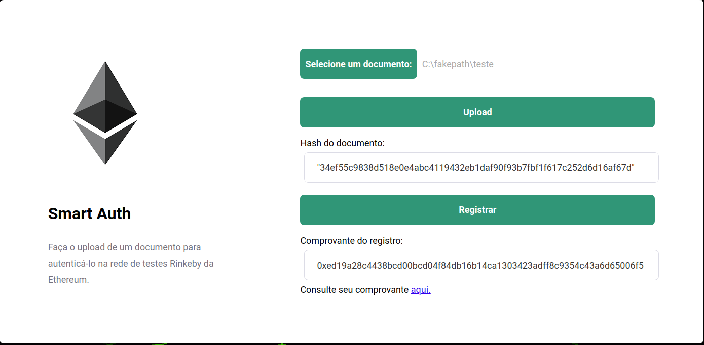

# Smart Auth

This app was developed as part of my final thesis for my Information Systems degree.
SmartAuth enables authentication of any digital file on Ethereum’s Rinkeby testnet.
The solution extracts each document’s hash, submits it to the blockchain via a smart contract, and allows verification that the document has not been altered or counterfeited.



### Prerequirements

```
Go-ethereum/Geth
Truffle.js
web3.js
```

## Built with

* Node.js
* ReactJS
* Axios

## Author

Rafael Rodrigues
